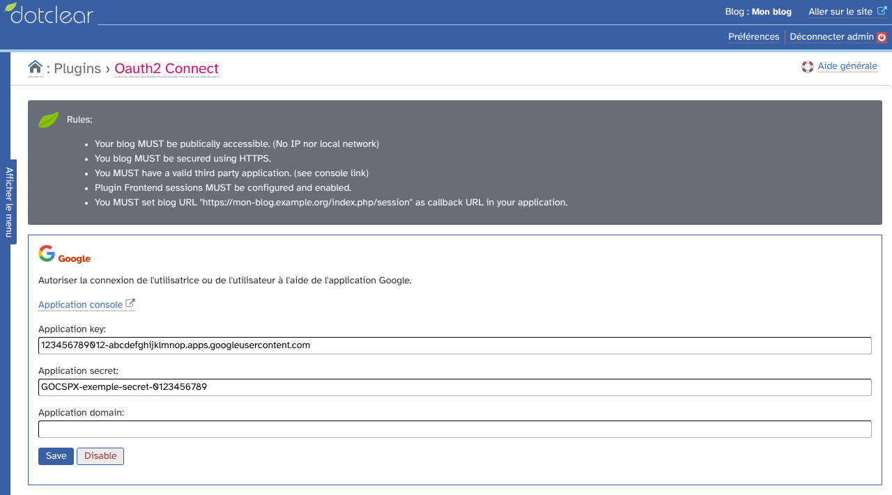
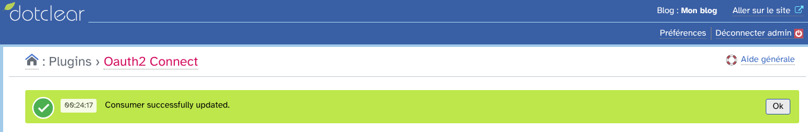
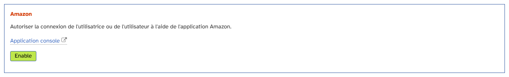
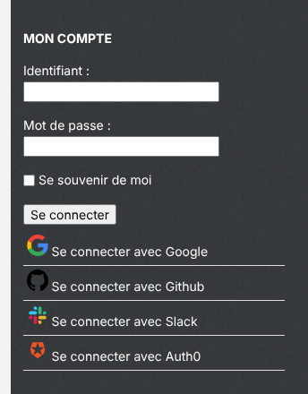
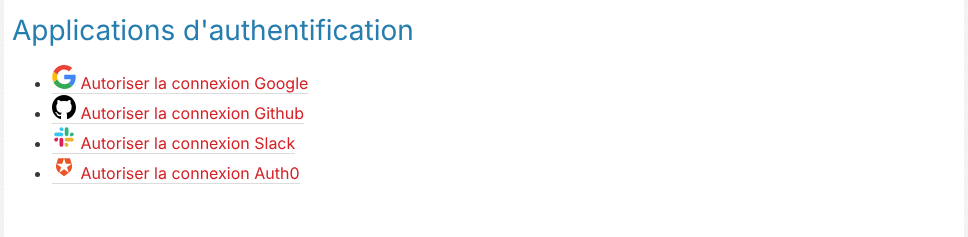

# Oauth2Connect : guide d'utilisation

Oauth2Connect permet aux membres de votre blog de se connecter avec un compte extérieur : Google, GitHub, Slack, Auth0 ou Amazon.
Ils n'ont plus besoin de saisir leur mot de passe sur votre blog.
Le plugin s'appuie sur le plugin FrontendSession, qui gère les comptes et les sessions sur le site public.

## Sommaire

* [Avant de commencer](#avant-de-commencer)
* [Ouvrir la page du plugin](#ouvrir-la-page-du-plugin)
* [Créer l'application chez le fournisseur](#créer-lapplication-chez-le-fournisseur)
* [Enregistrer l'application dans le blog](#enregistrer-lapplication-dans-le-blog)
* [Désactiver ou réactiver un fournisseur](#désactiver-ou-réactiver-un-fournisseur)
* [Ce que voient les visiteurs](#ce-que-voient-les-visiteurs)
* [Relier un compte, se connecter, révoquer](#relier-un-compte-se-connecter-révoquer)
* [Ce qu'il faut savoir](#ce-quil-faut-savoir)

## Avant de commencer

Quatre conditions sont nécessaires :

* le blog est ouvert sur Internet, avec un nom de domaine : ni adresse IP, ni réseau local ;
* le blog utilise HTTPS ;
* le plugin FrontendSession est installé, activé et configuré dans les préférences du blog ;
* vous avez créé une application chez le fournisseur choisi (voir plus bas).

Un membre doit aussi avoir un compte sur le blog, avec la permission « Frontend sessions ».
Oauth2Connect ne crée pas de compte : il ajoute seulement un autre moyen de se connecter à un compte existant.

## Ouvrir la page du plugin

Ouvrez le menu « Plugins », puis « Oauth2 Connect ».
La page est réservée aux administrateurs du blog.

La page affiche d'abord un encadré « Rules: » qui rappelle les conditions ci-dessus.
Sa dernière ligne donne l'adresse de rappel (« callback URL ») de votre blog, par exemple `https://mon-blog.example.org/index.php/session`.
Vous en aurez besoin chez le fournisseur.

Sous l'encadré, un bloc par fournisseur : Google, Github, Slack, Auth0 et Amazon.

Si la page affiche seulement « No service provider to configure », une des conditions n'est pas remplie.
Le plus souvent, l'adresse du blog n'est pas en HTTPS ou c'est une adresse IP.

## Créer l'application chez le fournisseur

Chaque fournisseur demande de déclarer une application.
Dans le bloc du fournisseur, le lien « Application console » ouvre sa page de gestion.

Pour chaque application :

1. Créez une nouvelle application.
2. Indiquez l'adresse de rappel donnée par l'encadré « Rules: » de la page du plugin.
3. Notez la clé (« client ID ») et le secret (« client secret ») fournis.

Les écrans des fournisseurs changent souvent : suivez leur documentation pour cette partie.

## Enregistrer l'application dans le blog

Dans le bloc du fournisseur, remplissez les champs :

* **Application key** : la clé de l'application ;
* **Application secret** : le secret de l'application ;
* **Application domain** : seulement pour Auth0. Saisissez l'adresse de votre compte Auth0 en commençant par `https://`, par exemple `https://mon-blog.eu.auth0.com`. Laissez vide pour les autres fournisseurs.

Cliquez sur « Save ».
La page affiche le message « Consumer successfully updated. »

Le fournisseur n'est proposé aux visiteurs que si la clé et le secret sont remplis.
Les libellés de cette page sont en anglais, même dans une interface en français.

## Désactiver ou réactiver un fournisseur

Pour retirer un fournisseur sans perdre ses réglages, cliquez sur « Disable » dans son bloc.
Le bloc ne montre plus que sa description et un bouton « Enable ».
Son bouton disparaît du site public.

Cliquez sur « Enable » pour le remettre en service.
Le bloc affiche de nouveau la clé et le secret enregistrés.

## Ce que voient les visiteurs

Les boutons n'apparaissent pas tout seuls : ils s'ajoutent aux éléments de FrontendSession.

* Dans le widget « Session publique » (titre « Mon compte » par défaut), un bouton « Se connecter avec Google » (ou Github, Slack…) apparaît sous le formulaire, pour les visiteurs non connectés. Ajoutez ce widget dans le menu « Widgets ».
* Dans la page de compte du membre connecté (la page `session` du blog), une section « Applications d'authentification » propose un bouton par fournisseur.

Voici le widget sur le blog :

Et la page de compte d'un membre connecté :

Un fournisseur désactivé, ou sans clé et secret, n'a pas de bouton.

## Relier un compte, se connecter, révoquer

Un membre doit d'abord relier son compte du blog à son compte extérieur.

1. Il se connecte au blog avec son identifiant et son mot de passe.
2. Sur sa page de compte, il clique sur « Autoriser la connexion Google » (ou un autre fournisseur).
3. Il est envoyé chez le fournisseur, qui lui demande d'accepter. Au retour, le compte est relié.

Ensuite, il peut se connecter en un clic :

1. Dans le widget, il clique sur « Se connecter avec Google ».
2. Il accepte chez le fournisseur si besoin.
3. Il revient sur le blog, connecté.

Pour défaire le lien, le membre clique sur « Révoquer la connexion à Google » sur sa page de compte.
Le bouton remplace « Autoriser la connexion » quand le compte est relié.

Si le compte extérieur n'est relié à aucun membre, la connexion échoue avec le message « This user is not registered on this blog. » : le membre doit d'abord relier son compte, comme décrit ci-dessus.

## Ce qu'il faut savoir

* Un compte extérieur se relie à un seul membre du blog. Les liens sont enregistrés par blog.
* Oauth2Connect ne crée jamais de compte : l'inscription reste celle de FrontendSession.
* Les clés et secrets sont enregistrés tels quels dans les réglages du blog, et affichés en clair sur la page du plugin.
* Le secret d'une application ne doit pas être partagé : seuls les administrateurs du blog voient cette page.
* Le blog doit rester accessible en HTTPS : sans cela, les fournisseurs disparaissent de la page et du site public.
